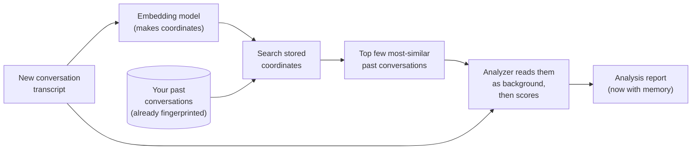

# RAG: giving the analyzer a memory

This doc explains the retrieval-augmented generation ("RAG") feature in plain
terms — what it does, how it works, and why each piece was chosen. The
technical spec (schema, env vars, PR plan) lives in the PR stack that
implements it; this doc is the version you can read without knowing the
codebase.

## 1. The problem in one sentence

Today the analyzer scores every conversation as if it's the first one you've
ever had — it has amnesia, and RAG gives it a memory.

When you submit a dating-app conversation, a worker sends it to the analyzer
service, which reads the transcript and writes feedback: how engaging each
stretch was, what went well, what to reflect on. Then the result is stored and
— here's the gap — never looked at again. The next conversation you submit is
scored in total isolation.

That means the analyzer can never say things like:

- "This opener pattern also appeared in your last three conversations."
- "Last time a conversation stalled the same way, the match went quiet too."

Those observations — *is this a habit? what happened before?* — are often the
most useful feedback a coach can give, and they are impossible to produce from
one transcript alone.

## 2. What RAG adds, in one sentence

Before scoring a conversation, we look up your *most similar* past
conversations and hand them to the analyzer as background reading — then we
file the new conversation away so future analyses can find it.

"RAG" stands for retrieval-augmented generation: **retrieve** relevant material
first, then let the AI **generate** its answer with that material in front of
it, instead of relying on what it happens to know. It's the difference between
asking someone a question cold and letting them check their notes first.

## 3. The core trick: turning text into points on a map

The whole system rests on one idea: **similar text lands at similar
coordinates.**

An *embedding* is a list of numbers — think of it as GPS coordinates, except
instead of latitude/longitude there are 1,536 dimensions. A special AI model
(an *embedding model*) reads a piece of text and outputs its coordinates. Two
texts about the same thing land near each other on this "map of meaning," even
if they use completely different words:

- "she never replied after I sent three jokes" and "the match went quiet after
  I tried too hard to be funny" land close together.
- "we talked about hiking for six messages" lands far away from both.

So "find my past conversations similar to this one" becomes "find the stored
coordinates closest to this one's coordinates" — which is a geometry question,
and databases are excellent at geometry.

## 4. The cast of characters

Three existing services each play a role, and none of them change jobs:

- **The worker** (Go, background process) is the office assistant. It already
  runs every analysis job: load the conversation, call the analyzer, save the
  result. RAG adds two errands to that job — *before* scoring: "fetch the
  similar past conversations"; *after* scoring: "file this one away."
- **The analyzer** (Python, ml-analyzer) is the specialist that does the
  thinking. It already talks to the AI providers, so it's also where
  fingerprint-making lives: a new `/embed` endpoint that turns text into
  coordinates. It stays *stateless* — it still doesn't own a database; it just
  answers questions.
- **Postgres** (the existing database) is the filing cabinet. A Postgres
  extension called **pgvector** — already installed — lets it store coordinate
  lists and answer "find the nearest" queries. Each finished conversation gets
  one row: its fingerprint, the text that produced it, and whose it is.

The API and the app change **not at all**. Everything happens inside a job
that already exists.

## 5. One analysis, start to finish

1. You submit a conversation. Same as today — a job lands on the queue.
2. The worker picks it up and makes a fingerprint of the new transcript
   (asks the analyzer's `/embed` endpoint).
3. The worker asks Postgres: "whose coordinates are closest to these — among
   *this user's* conversations only?" It keeps at most 4, and only if they're
   actually close (more on the cutoff below).
4. Those past conversations get attached to the request as a short "similar
   past conversations" section — like stapling a few old case files to the new
   one before handing it to the specialist.
5. The analyzer scores as usual, but the scoring prompt now includes that
   background section, framed as *context to notice recurrence*, not as
   instructions to follow.
6. The worker saves the result exactly as today. Then, as a last errand, it
   fingerprints the new conversation *plus its outcome summary* and files it —
   so next month's analysis can find it.

Step 6 is why the doc gets its outcome attached: "conversations that *looked*
like this one **and how they went**" is a much better match than looks alone.

## 6. Why each specific choice was made

### 6.1 Why pgvector (keeping it in Postgres) instead of a separate vector database

There are dedicated products for coordinate-searching (Pinecone, Qdrant,
Weaviate). We didn't need one:

- **Our filing cabinet is small.** Those products earn their keep at millions
  of fingerprints. We'll have thousands — maybe tens of thousands.
- **Deletion must just work.** When someone deletes their account, their
  fingerprints must die too. Inside Postgres, that's automatic: fingerprints
  are linked to the user and conversation rows they came from, and Postgres
  already cascades deletes. An external store would need a whole second
  cleanup pipeline — and a bug there means embedded copies of people's dating
  messages surviving account deletion.
- **Nothing new to run.** It's already in the compose Postgres image
  (PR #390). No new service, no new backups, no new thing that can fall over
  at 3am.

### 6.2 Why OpenAI's `text-embedding-3-small` for the fingerprinting

Choosing the embedding model decided the column width (`vector(1536)`) in the
migration — this one is effectively permanent, so it got the most thought:

- **Anthropic doesn't sell one.** The analyzer defaults to Anthropic for
  scoring, but Anthropic has no embeddings API at all — so embeddings get their
  own config (`EMBEDDING_PROVIDER`, `EMBEDDING_API_KEY`…) and can't
  accidentally follow the Anthropic default into a dead end.
- **The smaller model is genuinely enough.** OpenAI's bigger option
  (`text-embedding-3-large`) scores a few percent higher on benchmarks, costs
  ~6× more, and doubles the fingerprint size. At our scale — finding a handful
  of similar conversations inside *one user's* history, not a needle in the
  whole internet — the small model's results are indistinguishable in
  practice.
- **It's essentially free.** Around $0.02 per *million* words fingerprinted.
  Two fingerprints per analysis (one to search, one to file) rounds to zero —
  the scoring call costs thousands of times more.
- **Zero new dependencies.** The analyzer already talks to OpenAI-compatible
  APIs over HTTP; the embeddings endpoint is the same shape. No new libraries,
  and the service image stays lightweight.
- **Voyage is the understudy.** Voyage (Anthropic's recommended embedding
  partner) speaks the same API shape, so switching is an env var, not code.
- **A self-hosted model was rejected** because it would pull a deep-learning
  framework (torch) into the analyzer — roughly a gigabyte of dependencies the
  project deliberately keeps out of the serving image.

Honest caveat worth remembering: if we ever switch models, the fingerprints
don't transfer — a coordinate system is private to the model that made it. So
every stored row records which model produced it, and a switch means a
migration plus a "re-fingerprint everything" pass. The stored row keeps the
*text*, not just the fingerprint, precisely so re-fingerprinting is a replay,
not a reconstruction.

### 6.3 Why the worker drives retrieval instead of the analyzer doing it

The analyzer is intentionally a "pure function" service — text in, scores out,
no database. Giving it a database would mean two services owning Postgres
knowledge and a scorer that can't be tested without one. The worker already
has the database, already builds the analyzer's request, and already runs
off-line where a few hundred milliseconds of lookup doesn't touch anyone's
screen. It's the natural seam.

The alternative we rejected — a Go client calling OpenAI directly from the
worker — would split "who talks to AI vendors" across two languages. Keeping
all vendor calls behind the analyzer preserves one door to the outside world,
and its existing production auth covers the new endpoint for free.

### 6.4 Why only *your own* history is searched

Two reasons, and the second one matters most:

1. It's the useful signal — "is *this a pattern for you*" is the question
   longitudinal memory answers.
2. It's privacy by construction. Your report can only ever contain material
   you wrote, because the search is filtered to your rows before similarity is
   even measured. Other people's dating conversations can never leak into your
   feedback — not "we're careful about it," it's *structurally impossible*.

A shared pool across all users could be a phase 2 (with consent gating and
scrubbing), but that's a policy decision, not a technical one — so v1 stays
per-user.

### 6.5 Why "one fingerprint per conversation" instead of per message

The question being asked is "which past conversations resemble this one." If
we fingerprinted individual messages, we'd get back confetti — scattered
fragments — and have to reassemble conversations anyway. One row per
conversation matches the unit we actually want to show the analyzer, keeps the
index tiny, and the transcript is short enough to fit comfortably in one
fingerprint. (The schema still leaves room for chunked documents later, if a
different corpus ever needs them.)

### 6.6 Why "closest by angle" (cosine distance)

"How similar are two fingerprints" needs a yardstick. The chosen one —
cosine — measures the *angle* between two arrows on the map: same direction =
same meaning, regardless of arrow length. It's the standard yardstick for text
fingerprints, and it keeps working correctly even if a future provider's
fingerprints aren't normalized, which alternatives would silently break on.

The knobs:

- **Top 4 neighbors.** Enough to spot a recurring pattern; few enough that the
  extra reading material stays small next to the transcript itself (~2k tokens
  added to a ~30k-token prompt).
- **"Close enough" cutoff.** Only genuinely-similar conversations count —
  distance under ~0.35, i.e. "at least 65% alike." For a brand-new user the
  cabinet is empty and the answer is simply "nothing similar," which is fine:
  they get exactly today's behavior. A weak forced match would be worse than
  none.
- **Never match yourself.** The conversation being scored is excluded, which
  also prevents a re-analyzed conversation from matching its own stale
  fingerprint.

### 6.7 Why the index is a "map-organizer" (HNSW) even though we're small

Without an index, every search compares the new fingerprint against *every*
stored one — fine at a thousand rows, slow at a million. The HNSW index
pre-organizes the map into neighborhoods so Postgres can jump straight to the
right area. On an empty table it costs nothing to create, so it exists from
day one and the search quietly stays fast as the cabinet grows.

One subtlety: we filter by owner *while* searching the map. Older pgvector
could return short lists when the filter threw away most of what the map walk
found; version 0.8 (what we run) keeps walking until it finds enough matches.
Worst case without that fix is "fewer suggestions," never a wrong one.

## 7. What happens when things break

The design rule: **RAG is decoration, never a dependency.** Every step that
can fail degrades to "just score it like we do today":

| What breaks | What you get |
|---|---|
| No embedding key configured | Analysis works exactly as today (this is also how CI runs) |
| Fingerprint service down / slow | Analysis proceeds with no background reading |
| Filing the new conversation fails | Report is already saved; that one conversation just isn't findable later (a cleanup pass can repair it) |
| Nothing similar exists | Identical request to today |

And the worker's replay-safety is preserved: re-delivered jobs can't
double-score or double-file, because filing uses an "update if already there"
write.

## 8. What it costs

- **Money:** fractions of a cent per analysis. Ignorable next to the scoring
  call itself.
- **Time:** well under a second added to a background job that already takes
  tens of seconds. Users never wait on it.
- **Storage:** roughly 15–20 KB per conversation — a year of heavy use is a
  rounding error on the database volume.

## 9. What this deliberately does *not* do (yet)

- **No shared knowledge base** of curated coaching wisdom — the analyzer's
  coaching philosophy already lives in its prompts. Possible phase 2; the
  schema leaves room.
- **No cross-user matching** — needs consent and scrubbing decisions first.
- **No coach-facing retrieval** (e.g. "find similar cases from session
  notes") — a different audience and a different corpus.
- **No backfill** of conversations analyzed before RAG existed — the cabinet
  fills organically going forward; a backfill pass can be added if wanted.

## 10. Jargon decoder

| Term | Plain meaning |
|---|---|
| RAG | Look up relevant material first, then have the AI write its answer with that material in view |
| Embedding / vector | A text's coordinates on a "map of meaning" — a list of ~1,536 numbers |
| Embedding model | The AI that turns text into coordinates (we use OpenAI `text-embedding-3-small`) |
| pgvector | A Postgres add-on that stores coordinates and finds the nearest ones |
| HNSW index | A way of pre-organizing the map so "find the nearest" stays fast at scale |
| Cosine distance | Similarity measured as the angle between two fingerprints; smaller = more alike |
| Top-k | "Give me the k closest" — we use 4 |
| Digest | The trimmed-down transcript text we fingerprint |
| `rag_chunks` | The new table: one row per filed document (text + fingerprint + owner) |
| Owner-scoped retrieval | The search filter that limits matches to the same user's own history |
