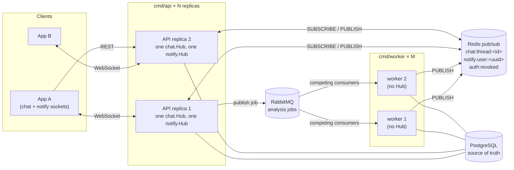
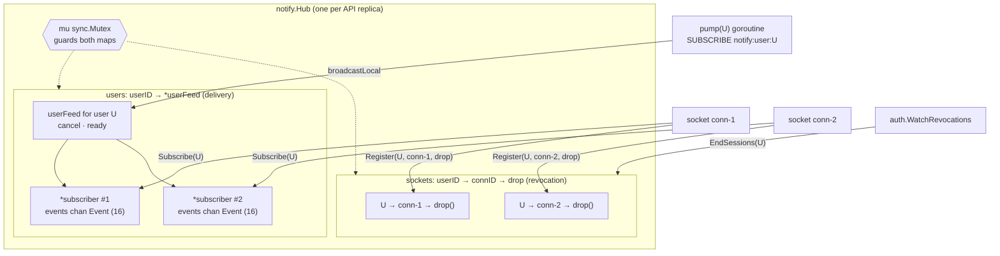
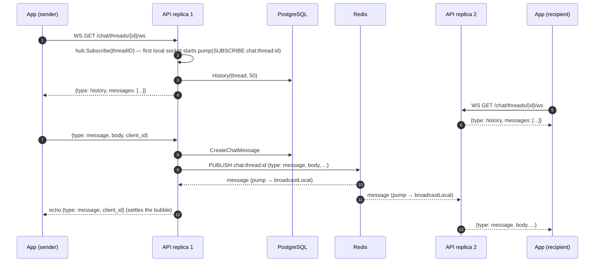
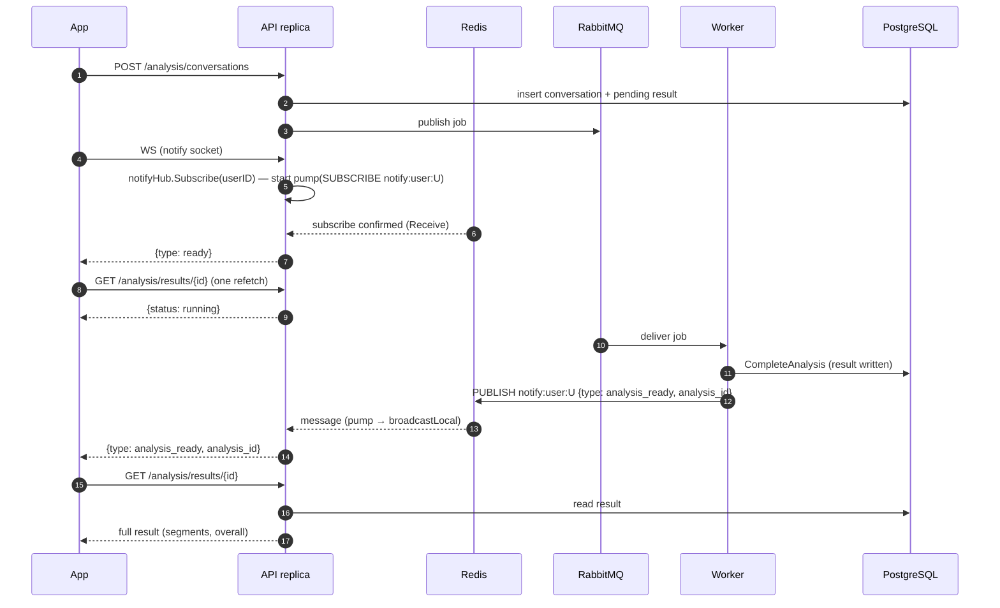
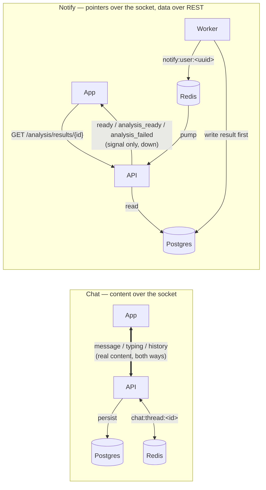
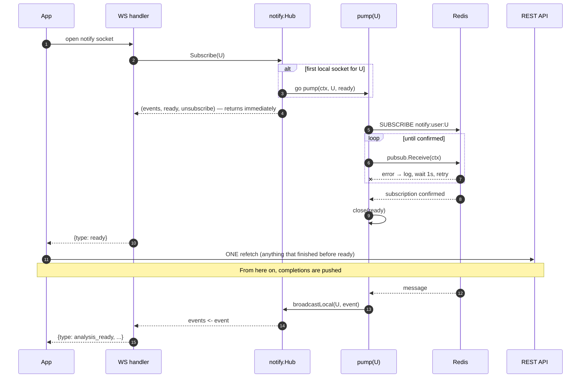
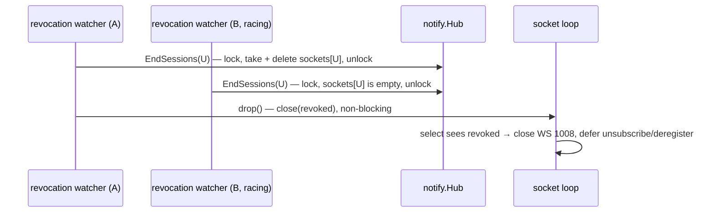
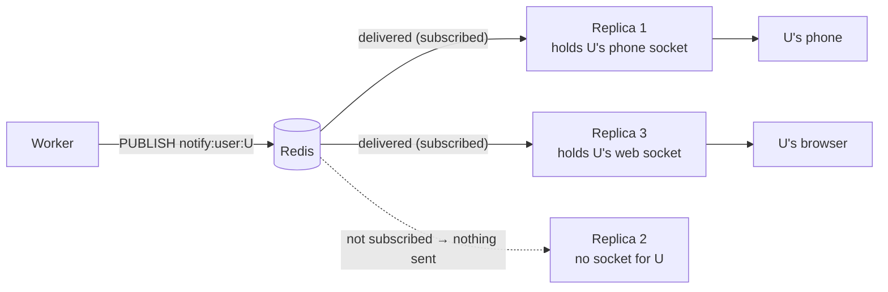

# Real-time delivery

How the backend pushes things to open sockets: live chat (`backend/internal/chat`) and the per-user notification hub (`backend/internal/notify/hub.go`).

> **Where the code lives.** `backend/internal/notify/hub.go` is added by [PR #189](https://github.com/danielliu30/dating-coach/pull/189) (commit `811cfe5a`) and exists only on that PR branch for now. On `main`, the `notify` package holds only the email/push `Relay` (`notify.go`, `outbox.go`). The publisher (`notify.Publish`, [PR #190](https://github.com/danielliu30/dating-coach/pull/190)), the notification WebSocket handler and route, the worker calls and the app's notification socket are later PRs in the same stack. This doc describes the `notify.Hub` as of `811cfe5a`. Later commits on the PR branch changed some of its behaviour; see [Changes on the PR branch since `811cfe5a`](#changes-on-the-pr-branch-since-811cfe5a).

## 1. Process topology

`backend/cmd/api` and `backend/cmd/worker` are two binaries built from one Go module (`backend/go.mod`), and they share the `internal/` packages. In production they run as separate processes, and there can be several of each.



**How to read this diagram.** Boxes are processes and cylinders are shared infrastructure. A two-headed arrow is a long-lived connection that carries traffic both ways, and a one-headed arrow is a write. Workers sit on the far side of RabbitMQ. Each analysis job goes to exactly one of them ("competing consumers"). API replicas never consume jobs. They passively hold sockets and wait for Redis to tell them something happened. The only path from a worker to a socket is through Redis, because there is no edge from a worker to a client.

- **One `Hub` per replica.** `cmd/api/main.go` builds exactly one `chat.NewHub(rdb)` and, once the notify route lands, one `notify.NewHub(rdb)`. Every socket on that replica goes through that one instance, and `auth.WatchRevocations` is started once per hub with `hub.EndSessions` as its callback.
- **Workers compete; API replicas hold.** RabbitMQ hands each analysis job to one worker. Which worker gets it has nothing to do with which replica holds the user's sockets.
- **Why Redis pub/sub bridges them.** A worker process constructs no `Hub` and holds no sockets. It cannot reach a socket directly, and it does not know which replica (if any) holds one for the user. So it publishes to a channel named after the user (`notify:user:<uuid>`). Any replica holding that user's sockets is already subscribed to that channel and delivers the event locally. Chat works the same way per thread: `chat.Service.Send` persists the message, then `Hub.Publish`es to `chat:thread:<id>`, and every replica with a socket on that thread delivers it.

## 2. The `notify.Hub` object

```go
type Hub struct {
	rdb *redis.Client

	mu      sync.Mutex
	users   map[uuid.UUID]*userFeed               // delivery
	sockets map[uuid.UUID]map[uuid.UUID]func()    // revocation: userID → connID → drop
}

type userFeed struct {
	subs   map[*subscriber]struct{} // each subscriber wraps events chan Event (cap 16)
	cancel context.CancelFunc       // stops this user's pump
	ready  chan struct{}            // closed once Redis confirms the SUBSCRIBE
}
```



**How to read this diagram.** The outer box is one replica's hub. The two inner boxes are its two maps. Dotted lines from `mu` show that one mutex guards both. Solid arrows on the left show which call creates which entry: a single socket (`conn-1`) creates **one entry in each map**, its `*subscriber` through `Subscribe` and its `drop` function through `Register`. On the right are the two writers that are not sockets. `pump` reads the delivery map, and the revocation watcher empties the revocation map.

- **`users` is for delivery.** It holds one `userFeed` per user with at least one local socket. Its `subs` set holds one `*subscriber` per socket, each with a buffered `chan Event` of capacity 16. (The set is keyed by the `*subscriber` pointer, not by connID. The hub never needs to look a delivery channel up by connection.)
- **`sockets` is for revocation.** It maps `userID → connID → drop`, where `drop` is the socket's kill switch.
- **One socket, two entries.** `Subscribe(userID)` writes the `users` entry. `Register(userID, connID, drop)` writes the `sockets` entry. Both return the function the socket must call on close (`unsubscribe` / `deregister`). The chat handler already follows this pattern (`hub.Subscribe(threadID)` then `hub.Register(principal.UserID, connID, drop)`). The notification WS handler in the stack does the same per user.
- **Why two maps.** The two aspects have different keys and different consumers. Delivery needs "every channel for this user", and revocation needs "every kill switch for this user". Neither needs the other's data. A delivery channel being closed (unsubscribe) and a socket being told to die (drop) are separate events. Keeping them apart means `EndSessions` never touches delivery state. The socket's own loop sees `revoked`, returns, and runs its deferred `unsubscribe` like any other close.
- **Why one lock.** Every operation is a check-then-act on a map: "does this user have a feed? if not, create it and start a pump", "was this the last subscriber? if so, delete the feed and cancel", "take this user's sockets and delete the entry". Each of these must be atomic with respect to the others. One `sync.Mutex` makes that true without reasoning about lock ordering between two mutexes.

## 3. The two flows, contrasted

Both hubs use the same machinery: a lazy per-key Redis subscription, one `pump` per key, and drop-on-full fan-out to buffered per-socket channels. They differ in what they carry and how they are addressed.

| | Chat (`chat.Hub`) | Notify (`notify.Hub`) |
|---|---|---|
| Addressing | per thread, `chat:thread:<threadID>` | per user, `notify:user:<userID>` |
| Direction over the WS | **bidirectional**: client sends `message`, `typing`, `presence`; server pushes `message`, `typing`, `history`, `error` | **server → client only**: `ready`, `analysis_ready`, `analysis_failed` |
| Payload | **real content**: message body, sender, timestamps; `history` carries the last 50 messages | **a pointer**: `Event{Type, AnalysisID, ConversationID}`. The client fetches the real data over REST from Postgres |
| Recovery on (re)connect | server pushes `history` on the socket as soon as it is accepted | server sends `ready`, then the client does one REST refetch |
| Publisher | the API itself (`chat.Service.Send` / `Typing`) | any process; the worker is the main one |

### Chat flow



**How to read this diagram.** Time runs top to bottom. Solid arrows are requests or frames initiated by the sender. Dashed arrows are pushes or replies. Steps 1–5 are connection setup: each socket immediately receives a `history` frame with real content, which is how a reconnecting chat client recovers what it missed. Steps 6–11 show one message: it is persisted first, then published once to the thread channel. Redis delivers it to **every** replica subscribed to that thread, including the sender's own, so the sender gets its echo the same way the recipient gets the message.

### Notify flow



**How to read this diagram.** Same conventions as above. The thing to notice is what the WebSocket carries (steps 7 and 14): only small signals, never the analysis itself. Every piece of real data (steps 9 and 17) comes over REST from Postgres. The worker writes the durable result **before** it publishes (steps 11 → 12), so whenever a client reacts to a signal, the data is already there to fetch.

### The asymmetry at a glance



**How to read this diagram.** Thick double-headed arrows carry real content. Thin one-headed arrows carry signals or requests. On the chat side, the socket itself is the data path in both directions. On the notify side, the socket only points down (API → App), and the data comes back on a separate REST arrow. The publisher (worker) is also a different process from the socket holder (API), with Redis between them.

## 4. Connection lifecycle and the `EventReady` handshake



**How to read this diagram.** `alt` is the branch taken only for a user's first socket on this replica. Later sockets join the existing feed and share its `ready` channel. The `loop` is `pump` retrying `pubsub.Receive()` once a second until Redis confirms. The important ordering is around `close(ready)`. Before it, a published event might not reach this replica. After it, every event will (within the at-most-once guarantees in §5). The single REST refetch after `ready` covers exactly the gap before it.

- **`Subscribe` never blocks on Redis.** It registers the subscriber and, if needed, starts `pump`, all under the lock. It returns `(events, ready, unsubscribe)` at once. A socket handler must not tell the client "you're live" until `ready` is closed.
- **`pump` confirms, then signals.** `rdb.Subscribe` sends the command lazily, so `pump` calls `pubsub.Receive(ctx)` until it returns the subscription confirmation (logging and retrying every second, and giving up only when `ctx` is cancelled). Then it calls `close(ready)`. Closing a channel wakes every waiter, so all sockets that joined during the wait get the signal.
- **Then exactly one refetch.** On `EventReady`, the client fetches current state over REST one time. Anything that completed before `ready` shows up in that fetch, and anything that completes after arrives as a push. Nothing falls in between.
- **This makes push event-reactive, like a webhook.** The client does not poll. It reacts to a signal and does one recovery fetch per (re)connect. Today `AnalysisResultScreen` still polls `GET /analysis/results/{id}` every 2s (`POLL_MS = 2000`) until the status leaves `pending`/`running`. That is only because the client notification socket is not wired yet. The publisher side is [PR #190](https://github.com/danielliu30/dating-coach/pull/190), and the app socket and screen changes come later in the same stack.

## 5. Correctness and concurrency design decisions

### `pump`: one goroutine per user, `Channel()` not `ReceiveMessage()`

After `ready`, `pump` loops over `select { case <-ctx.Done(): …; case msg := <-pubsub.Channel(): … }`.

- **Why `Channel()`.** A blocking `ReceiveMessage` does not wake up when `ctx` is cancelled. So the last socket leaving could not end the subscription, and the goroutine and Redis subscription would leak. `Channel()` can be abandoned at any time, so `select` covers both cancellation and messages.
- **What it does with a message.** It JSON-decodes `msg.Payload` into an `Event` (logging and skipping malformed payloads) and calls `broadcastLocal(userID, event)`.
- **What it does not do: locate the user.** `pump` never inspects the payload to work out who it is for. The **channel name is the address**. This pump subscribed to `notify:user:<U>`, so every message on it belongs to `U`. Routing is done by Redis, not by the hub.

### `broadcastLocal`: never block, drop on full, log a warning

Under the lock, for each subscriber of the user: `select { case sub.events <- event: default: slog.Warn("dropping notification for slow client", …) }`.

- One slow socket must not stall `pump`, which would stall every other socket the user has on this replica. It also must not hold the mutex while waiting, which would stall every user on the replica.
- A dropped push is only a delay: the client refetches on its next (re)connect. (See [Changes on the PR branch](#changes-on-the-pr-branch-since-811cfe5a): the branch now cuts off the socket instead of skipping the event, so the reconnect actually happens.)

### `EndSessions`: remove, then invoke

```go
h.mu.Lock()
conns := h.sockets[userID]
delete(h.sockets, userID)
h.mu.Unlock()
for _, drop := range conns { drop() }
```



**How to read this diagram.** Two revocation announcements for the same user race. The first takes the entire `sockets[U]` entry and deletes it while holding the lock. The second finds nothing. So each `drop` runs **exactly once**, without per-connection flags, and outside the lock. The last arrow is the socket's own goroutine reacting. The hub never touches the connection.

- **Exactly-once without the lock held.** Swapping the entry out under the lock is what makes `drop` exactly-once. Calling `drop` after unlocking means a slow callback cannot stall delivery for every user on the replica.
- **The `drop` contract (documented on `Register`).** `drop` runs on the caller's goroutine, which is the revocation watcher, so it **must not block**. It should signal the socket's own loop rather than write to or close the connection. The chat handler's `drop` is `sync.OnceFunc(func() { close(revoked) })`, and the socket's `select` picks up `revoked` and closes with `1008 session revoked`.
- **`deregister` on close** removes a socket's entry so a later revocation cannot call a `drop` belonging to a connection that is already gone.

### Lazy feed lifecycle

- **First socket creates.** `Subscribe` finds no `users[U]`, so it creates the `userFeed`, a `context.WithCancel`, and the `ready` channel, and starts `pump`.
- **Last socket cancels.** `unsubscribe` removes the subscriber and closes its channel. If `subs` is now empty, it deletes `users[U]` and calls `feed.cancel()`, which makes `pump` return and `pubsub.Close()` end the Redis subscription.
- **Idempotent.** `unsubscribe` checks that the subscriber is still in the set before closing, so calling it twice cannot double-close a channel. `sockets` follows the same pattern: `Register` creates the inner map on first use, and `deregister` deletes it when empty.
- So a replica holds Redis subscriptions only for users who have a socket open on it **right now**.

### Why a single coarse mutex

- **Who touches the maps.** There are N socket-handler goroutines (`Subscribe`, `unsubscribe`, `Register`, `deregister`), one `pump` per active user (`broadcastLocal`), and the revocation watcher (`EndSessions`). These are all independent goroutines writing to the same maps.
- **Go maps are not safe for concurrent mutation.** A concurrent write together with any other access is a fatal runtime error (`concurrent map writes`), which no `recover` can catch. Optimistic schemes such as version counters or compare-and-retry detect a conflict after the fact. They cannot stop two goroutines from mutating the map's internals at the same moment, so they cannot replace mutual exclusion here.
- **Critical sections are tiny and never block.** Every locked region is a few map operations, a `go` statement, a `close`, or a non-blocking `select` send. Nothing waits on I/O, Redis, or a channel while holding `mu`. Contention is therefore negligible, and one lock buys atomic check-then-act across both maps (§2) with no lock-ordering hazards. A `sync.RWMutex` or per-user locks would add complexity with no measurable benefit at this scale.

### Deliberately lossy, at-most-once delivery

Redis pub/sub delivers each message at most once, to whoever is subscribed at that moment. Nothing is replayed after a disconnect. The hub adds its own drop points (full buffers, no local socket, a replica mid-reconnect). This is a deliberate choice:

- **Postgres plus REST is the backstop.** The worker writes the analysis row (and the `notifications` row) before publishing. The client's refetch on `ready` reads that durable state. A lost push costs latency, never correctness.
- **Same model as revocation.** `auth/revocation.go` documents the identical caveat on `WatchRevocations`: Redis pub/sub drops messages published while a replica is disconnected and does not replay them, so the announcement is "a latency optimisation over their own durable check, never as the only thing standing between a revoked account and its still-open connections." Chat sockets back that up with their `accountRefresh` (15s) re-check of the account row. Notifications back it up with the REST refetch.
- **Why not at-least-once.** At-least-once would mean per-user durable queues, acks, and redelivery state in the API tier. That duplicates what Postgres already holds, and the client would still need a refetch path for the first connect.

## 6. Fan-out across replicas and sharding



**How to read this diagram.** Solid arrows are deliveries that happen, and the dotted arrow is one that does not. Because subscriptions are lazy and per user, Redis sends a user's event only to the replicas that currently hold that user's sockets. Replica 2 never subscribed to `notify:user:U`, so it receives nothing and spends nothing. A user with several devices on different replicas gets the event on each.

- **Cost scales with active sockets, not replicas.** A publish is delivered to each replica subscribed to that one channel, and no replica filters out traffic meant for other users. Chat is the same, per thread.
- **Redis Cluster caveat.** Classic `SUBSCRIBE`/`PUBLISH` in Redis Cluster broadcasts every published message to **every node** in the cluster, so throughput does not scale with shards. If we move to Cluster, use **sharded pub/sub** (`SSUBSCRIBE`/`SPUBLISH`, Redis 7+; `rdb.SSubscribe` / `rdb.SPublish` in go-redis with a `ClusterClient`). The channel name is hashed to a slot like a key, and the message stays on the shard that owns that slot. Do **not** pin each API replica to one Redis shard (e.g. "replica i subscribes on shard i"). The user's channel lives on whichever shard owns its slot, not on the shard a replica happens to be pinned to, and a user's sockets can be on any replica. Let slot routing decide where each `notify:user:<uuid>` lives.

## Changes on the PR branch since `811cfe5a`

The PR #189 branch moved on after `811cfe5a` in response to review. The design above still holds, with these refinements:

- **A full buffer cuts the socket off instead of dropping the event** (`7bcade9`). `broadcastLocal` now removes the subscriber, closes its channel, and cancels the feed if it was the last one. Skipping only the event could leave a client waiting on a push that never comes. Closing the channel ends the socket, so the client reconnects, gets `ready`, and refetches.
- **A stale pump cannot feed a newer subscription** (`7bcade9`). `pump` now receives its `*userFeed`, and `broadcastLocal` only delivers if `h.users[userID] == feed`. A pump cancelled by the last socket leaving may still hold one final message, and that message must not reach sockets that belong to a fresh feed for the same user.
- **A restored Redis subscription cues a refetch** (`1f6b2ca`). `pump` reads `pubsub.ChannelWithSubscriptions()`. When go-redis resubscribes after losing its connection (a `*redis.Subscription` with `Kind == "subscribe"`), the hub broadcasts `EventReady` again, because pub/sub did not replay what was published in the meantime.
- **`notify.Publish`** ([PR #190](https://github.com/danielliu30/dating-coach/pull/190), `publish.go`) is the fire-and-forget publisher the worker uses. Its doc comment restates the same contract: callers must keep a durable record that clients refetch.

## Source map

| File | Role |
|---|---|
| `backend/internal/notify/hub.go` *(PR #189 branch)* | per-user notification hub, `Event`, `UserChannel` |
| `backend/internal/notify/notify.go`, `outbox.go` *(main)* | email/push `Notifier` and outbox `Relay` (not real-time) |
| `backend/internal/chat/hub.go` | per-thread chat hub, presence, `Publish` |
| `backend/internal/chat/handler.go` | chat WS handler: `Subscribe` + `Register`, `history` on join, revocation / expiry / heartbeat |
| `backend/internal/auth/revocation.go` | `Denylist`, `WatchRevocations` (best-effort announcement) |
| `backend/internal/analysis/worker.go` | analysis job handler; writes the result, then notifies |
| `backend/cmd/api/main.go` | builds one hub per replica, wires `WatchRevocations` → `hub.EndSessions` |
| `app/src/api/socket.ts` | `ChatSocket`: reconnect with backoff, outbox replay, token renewal |
| `app/src/screens/ChatScreen.tsx` | settles bubbles against `history` on (re)connect |
| `app/src/screens/AnalysisResultScreen.tsx` | polls the result every 2s until push is wired |
